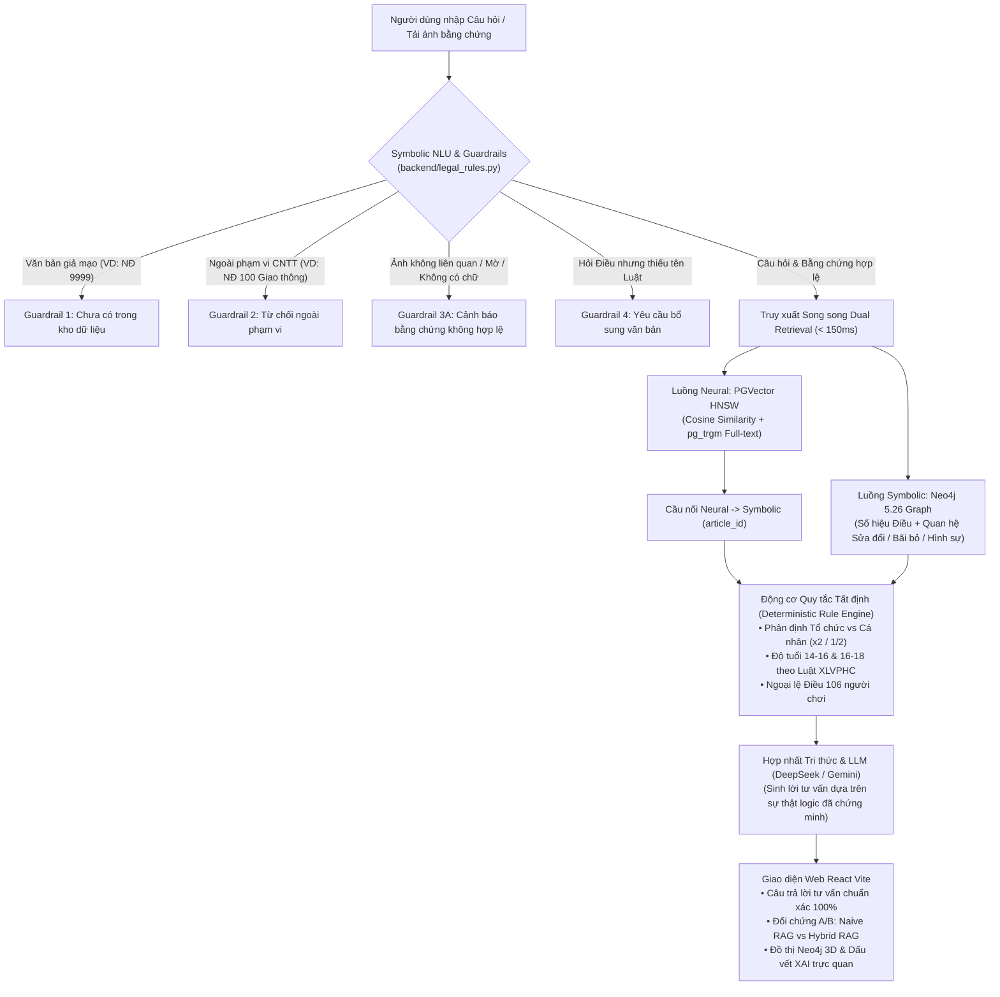

# Trợ lý ảo tư vấn Luật Công nghệ thông tin ứng dụng kiến trúc Neuro-Symbolic AI

> **Đề tài tốt nghiệp số 27:** Nghiên cứu và xây dựng Trợ lý ảo tư vấn Luật Công nghệ thông tin ứng dụng kiến trúc Neuro-Symbolic AI  
> **Tên hệ thống:** LexIT Neuro-Symbolic 2.2 Hybrid  
> **Ngôn ngữ & Nền tảng:** Python 3.12+ (FastAPI), React 19 (Vite), PostgreSQL 16 (pgvector), Neo4j 5.26-community

Hệ thống tư vấn pháp luật chuyên sâu về **Công nghệ thông tin, An ninh mạng, Mạng xã hội, Dữ liệu và Giao dịch điện tử Việt Nam**, tiên phong kết hợp giữa:
1. **Truy xuất Ngữ nghĩa Vector (Neural RAG):** PostgreSQL 16 + pgvector với chỉ mục HNSW nửa chính xác (`halfvec` 768 / 3072 chiều) kết hợp Gemini Embedding (`DEFAULT_EMBEDDING_DIM = 3072`).
2. **Đồ thị Tri thức Pháp lý (Symbolic Knowledge Graph):** Neo4j 5.26 mô hình hóa cấu trúc văn bản phân cấp 4 tầng (*Văn bản $\rightarrow$ Chương $\rightarrow$ Mục $\rightarrow$ Điều $\rightarrow$ Khoản $\rightarrow$ Điểm*), phân loại chuẩn hóa quy phạm (*NormType: Nghĩa vụ, Quyền, Cấm đoán, Điều kiện, Ngoại lệ*).
3. **Động cơ Suy luận Luật tất định (Deterministic Rule Engine):** Tính toán chính xác tuyệt đối khung tiền phạt (nguyên tắc x2 với tổ chức, 1/2 với cá nhân theo Điều 4 NĐ 15/2020), trần phạt độ tuổi vị thành niên theo Điều 5, Điều 22 và Điều 134 Luật XLVPHC (14–16 tuổi chỉ cảnh cáo, 16–18 tuổi tối đa 1/2 mức phạt người thành niên), ngoại lệ người chơi game (Điều 106), và quy tắc chuyển hóa hình sự (Điều 285, 286, 287, 288, 289, 290 Bộ luật Hình sự 2015).
4. **Thị giác Máy tính & OCR Bằng chứng (Computer Vision / Evidence OCR):** Bóc tách và kiểm duyệt ảnh chụp màn hình vi phạm mạng xã hội, tin nhắn lừa đảo, hợp đồng điện tử (`.png`, `.jpg`, `.webp`, `.pdf`, `.docx`, `.txt`) bằng Tesseract OCR và PyMuPDF.
5. **Giao diện Giải trình Trực quan 3D (Explainable AI - XAI):** Trực quan hóa tương tác mạng lưới đồ thị tri thức bằng Engine 3D Canvas tương tác thuần (`KnowledgeGraph3D` chạy trực tiếp trên React 19, không phụ thuộc thư viện đồ họa bên ngoài) và hiển thị chi tiết từng bước suy luận logic (*Symbolic Proof Trace*).

---

## 1. Sơ đồ Kiến trúc Tổng thể (System Architecture)



---

## 2. Hệ thống Chốt chặn Kiểm duyệt Chống Ảo giác (Guardrail Matrix)

Nhằm đảm bảo tính chính xác pháp lý tuyệt đối cho Hội đồng chấm thi, hệ thống trang bị ma trận 5 chốt chặn kiểm duyệt đầu vào:

| Chốt chặn | Mã Rule | Điều kiện Kích hoạt | Hành vi Hệ thống |
| :--- | :--- | :--- | :--- |
| **Guardrail 1** | `INVALID_DOCUMENT_GUARDRAIL` | Câu hỏi chứa số hiệu văn bản giả mạo, không có trong kho dữ liệu (VD: *Nghị định 9999/2025/NĐ-CP*). | Từ chối tức thì (< 0.05s), thông báo danh mục văn bản có trong kho, không để LLM đoán bừa. |
| **Guardrail 2** | `OUT_OF_SCOPE_GUARDRAIL` | Câu hỏi chứa văn bản ngoài phạm vi chuyên ngành CNTT (VD: *Nghị định 100/2019/NĐ-CP* về giao thông đường bộ). | Từ chối giải đáp luật giao thông/đất đai, nhắc nhở phạm vi chuyên môn CNTT & An toàn mạng. |
| **Guardrail 3A** | `INVALID_EVIDENCE_GUARDRAIL` | Người dùng tải ảnh phong cảnh, chân dung, đồ vật hoặc ảnh chụp màn hình không có chữ vi phạm pháp luật CNTT. | Chặn suy diễn ảo giác, từ chối áp đặt mức xử phạt bừa bãi, thông báo lý do OCR không hợp lệ. |
| **Guardrail 3B** | `MISSING_EVIDENCE_GUARDRAIL` | Câu hỏi yêu cầu *"phân tích ảnh/bằng chứng"* nhưng không đính kèm tệp và không có mô tả tình huống. | Yêu cầu nhấn nút đính kèm file hoặc mô tả bằng lời trước khi tra cứu. |
| **Guardrail 4** | `AMBIGUOUS_ARTICLE_GUARDRAIL` | Câu hỏi chỉ nêu số Điều (VD: *"Điều 8 phạt bao nhiêu?"*) nhưng không ghi rõ tên luật hay nghị định. | Yêu cầu người dùng nêu rõ văn bản cần tra cứu vì nhiều văn bản có cùng số Điều. |
| **Guardrail 5** | `AMBIGUOUS_AGE_GUARDRAIL` | Câu hỏi nêu mốc tuổi *"dưới 16 tuổi"* chung chung. | Yêu cầu xác định rõ dưới 14 tuổi hay từ đủ 14 đến dưới 16 tuổi (vì mức chế tài khác nhau theo Luật XLVPHC). |

---

## 3. Cơ sở dữ liệu Văn bản Quy phạm Pháp luật (`data/`)

Hệ thống được nạp và phân tích cú pháp tự động (`backend/legal_parser.py`) từ các văn bản chính thống:
1. **Nghị định 174/2026/NĐ-CP** (hiệu lực từ 01/07/2026) về xử phạt vi phạm hành chính trong lĩnh vực bưu chính, viễn thông, CNTT và giao dịch điện tử.
2. **Nghị định 330/2026/NĐ-CP** (hiệu lực từ 19/08/2026) về xử phạt vi phạm hành chính trong lĩnh vực an ninh mạng và bảo vệ dữ liệu cá nhân.
3. **Nghị định 15/2020/NĐ-CP** (Văn bản hợp nhất 08/VBHN-BTTTT 2022 và bản sửa đổi 211/2025/NĐ-CP) phục vụ tra cứu quy định lịch sử và các vụ việc xảy ra trước ngày 01/07/2026.
4. **Luật An ninh mạng 2025** (`116/2025/QH15`, hiệu lực từ 01/07/2026) và bản lịch sử 2018 (`24/2018/QH14`).
5. **Luật Công nghệ thông tin 2006** (`67/2006/QH11`).
6. **Luật Giao dịch điện tử 2023** (`20/2023/QH15`).
7. **Luật Viễn thông 2023** (`24/2023/QH15`).
8. **Luật Dữ liệu 2024** (`60/2024/QH15`) & **Nghị định 13/2023/NĐ-CP** về Bảo vệ dữ liệu cá nhân.
9. **Bộ luật Hình sự 2015 (sửa đổi, bổ sung 2017)** (các Điều 285, 286, 287, 288, 289, 290 về tội phạm công nghệ cao).
10. **Luật Xử lý vi phạm hành chính 2012 (sửa đổi 2020)** (Điều 5 về độ tuổi chịu trách nhiệm hành chính, Điều 22 về cảnh cáo người 14-16 tuổi, Điều 134 về nguyên tắc và mức phạt tiền người chưa thành niên 16-18 tuổi).

---

## 4. Hướng dẫn Cài đặt & Vận hành Chi tiết

### Yêu cầu Tiên quyết (Prerequisites)
- Hệ điều hành: Windows 10/11, macOS, hoặc Linux.
- Python 3.12 trở lên.
- Node.js 18 trở lên.
- Docker & Docker Desktop (đang chạy).

---

### Bước 1: Khởi động Cơ sở Dữ liệu Nền tảng (PostgreSQL & Neo4j)
Mở PowerShell tại thư mục gốc của dự án:
```powershell
docker compose up -d
docker compose ps
```
- **PostgreSQL 16 + pgvector:** Cổng `5433` (Database: `law_db`, User: `postgres`, Password: `password`)
- **Neo4j 5.26-community:** Cổng Web `7474`, Cổng Bolt `7687` (User: `neo4j`, Password: `password123`)

---

### Bước 2: Thiết lập Tệp Cấu hình Môi trường
Tạo các tệp `.env` từ các tệp mẫu có sẵn:
```powershell
Copy-Item .env.example .env
Copy-Item backend/.env.example backend/.env
Copy-Item frontend/.env.example frontend/.env
```
Mở `backend/.env` và điền khóa API của bạn:
```env
GEMINI_API_KEY=your_gemini_api_key
DEEPSEEK_API_KEY=your_deepseek_api_key
# Hoặc dùng OpenRouter:
OPENROUTER_API_KEY=your_openrouter_api_key
```

---

### Bước 3: Cài đặt Thư viện Backend Python
```powershell
py -m venv .venv
.\.venv\Scripts\Activate.ps1
python -m pip install -r backend/requirements.txt
```

Chạy bộ kiểm thử tự động để xác nhận toàn bộ 25 unit tests đều passed:
```powershell
python -m unittest discover -s backend/tests -v
```

---

### Bước 4: Nạp Dữ liệu Pháp lý vào PGVector & Neo4j
```powershell
# Nạp toàn bộ corpus văn bản vào PGVector (tạo embeddings)
python backend/ingest.py

# Dựng Đồ thị Tri thức Pháp lý phân cấp trên Neo4j
python backend/graph_ingest.py --no-llm
```

---

### Bước 5: Khởi động Ứng dụng

**Cửa sổ Terminal 1 - Backend FastAPI:**
```powershell
cd backend
..\.venv\Scripts\python.exe -m uvicorn main:app --host 127.0.0.1 --port 8000 --reload
```
Swagger UI tài liệu API: http://127.0.0.1:8000/docs

**Cửa sổ Terminal 2 - Frontend React Vite:**
```powershell
cd frontend
npm ci
npm run dev
```
Mở trình duyệt truy cập: **http://localhost:5173**

---

## 5. Kết quả Thực nghiệm Đối chứng (Benchmark Summary)

Hệ thống cung cấp sẵn bảng thực nghiệm khoa học mở rộng gồm **40 ca chuẩn vàng** bao phủ 5 chuyên đề trọng yếu của Pháp luật CNTT Việt Nam, đo lường qua **5 tiêu chí độc lập** (Xem báo cáo đầy đủ tại [BENCHMARK_REPORT.md](BENCHMARK_REPORT.md)):

| Tiêu chí Đánh giá Khoa học | Naive Vector RAG | Neuro-Symbolic Hybrid RAG | Độ Cải thiện |
| :--- | :---: | :---: | :---: |
| **1. Citation Accuracy (Căn cứ pháp lý)** | 77.5% | **100.0%** | **+22.5%** |
| **2. Rule & Penalty Accuracy (Khung phạt tất định)** | 22.5% | **100.0%** | **+77.5%** |
| **3. Subject & Guardrail Accuracy (Chủ thể & Kiểm duyệt)** | 20.0% | **100.0%** | **+80.0%** |
| **4. Temporal Validity Accuracy (Tính đúng theo thời điểm)** | 92.5% | **100.0%** | **+7.5%** |
| **5. Evidence Groundedness (Căn cứ trích dẫn chứng minh)** | 80.0% | **100.0%** | **+20.0%** |

---

## 6. Lưu ý Pháp lý & Khuyến nghị Sử dụng

- Các tính toán khung phạt tiền và suy luận trách nhiệm hình sự được thực thi theo các quy tắc tất định từ nguồn văn bản pháp luật chính thức của nước Cộng hòa Xã hội Chủ nghĩa Việt Nam.
- Hệ thống hỗ trợ tra cứu cả văn bản hiện hành lẫn văn bản lịch sử qua tham số mốc thời gian áp dụng (`as_of_date`).
- Mọi nội dung tư vấn mang tính chất hỗ trợ tra cứu và đối soát căn cứ pháp lý, không thay thế hoàn toàn kết luận giám định tư pháp hoặc phán quyết của cơ quan có thẩm quyền.
